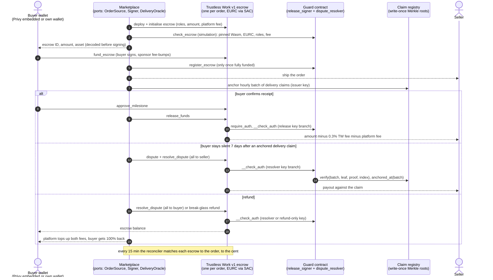

# motored-stellar

EURC escrow for a used car parts marketplace, on Stellar: a guard contract that limits what the
marketplace's keys can do with a Trustless Work escrow, a write-once registry of delivery claims,
and TypeScript adapters for EURC, wallets, ramps and reconciliation.

Built by UAB Motored, which runs a live used car parts marketplace ([motored.lt](https://motored.lt)),
as the open-source, chain-side part of the EURC integration it has proposed for a Stellar Community
Fund (SCF #46) Integration Track award. Everything in this repository at the time of that proposal
is pre-award work and is not billed to the award.
Everything here is standalone: nothing imports the marketplace's private order system. Where a
marketplace plugs in, there is a small typed port (`OrderSource`, `DeliveryOracle`, `Signer`,
`LedgerSource`, ...) with an in-memory implementation used by the tests and the example.

> **Status: testnet only, unaudited.** Do not hold real value with this code before an external
> review. See [SECURITY.md](SECURITY.md).

## For reviewers: what is proven today

- **On testnet, before this repository existed:** guard v0.6 to v0.8 (three lab runs on 24 Oct
  2026) holding the release signer and dispute resolver roles on escrows built from Trustless
  Work's own testnet Wasm (`7c3f7b2a`): a guard-authorised release after buyer approval, a seller
  payout against a depth-32 delivery claim verified inside `__check_auth`, a break-glass refund,
  the buyer's contest, overfunding and dust cases. Every tx is linked in
  [docs/testnet-proofs.md](docs/testnet-proofs.md). A lab-issued asset stood in for EURC and the
  7-day windows were shortened to 120 s.
- **In this repository:** the guard and registry contracts, the TypeScript adapters (escrow,
  claims, EURC, wallets, ramps, reconciler), the testnet scripts and their unit tests, and a CI
  workflow. The guard tests run every rule against both deployed Trustless Work Wasm files.
- **On testnet, from this repository's own scripts:** run 4, 28 Oct 2026 (guard v0.8 and the claim
  registry; every escrow ran Trustless Work's own testnet Wasm `7c3f7b2a`, created by an
  escrow-factory instance this run deployed from that Wasm, calling its built-in deployer function;
  release and resolve go straight to the escrow contract, because the guard authorises through a
  Soroban auth entry checked in its `__check_auth`, which the API's unsigned-XDR flow for G-account
  signers does not build, so we build and simulate those calls ourselves;
  a release after buyer approval with a
  claim re-check, a dispute refund with the fee top-up, a partial-funding break-glass refund; an
  XEUR lab asset stood in for EURC; refused paths were simulations). Every tx is linked in
  [docs/testnet-proofs.md](docs/testnet-proofs.md#run-4-guard-v08-from-this-repositorys-scripts-28-oct-2026-0937-to-0939-utc).
  Run 5, 28 Oct 2026, on the same deployment (`npm run testnet:e2e-claims`): the silent-buyer
  payout (escrow funded, buyer silent, platform dispute, a delivery claim anchored in the registry
  with a 32-level Merkle proof that the guard checked inside `__check_auth`, the seller paid through
  dispute resolution after the 120 s delay, then a public re-check of the claim) and the buyer
  contest (buyer approval, seller dispute, the buyer's `contest` on the guard inside the window,
  the seller payout refused with `Contested` = 25 in simulation, the whole balance refunded to the
  buyer and the fees topped up). The delivered event came from a mock oracle, not a carrier. Every
  tx is linked in
  [docs/testnet-proofs.md](docs/testnet-proofs.md#run-5-silent-buyer-and-buyer-contest-from-this-repositorys-scripts-28-oct-2026-2208-to-2211-utc).
  Run 6, 29 Oct 2026, on the same deployment (`npm run testnet:refusals`): four refused payouts
  landed on the ledger as **failed transactions** carrying the guard's own error code, each
  followed by the legitimate settlement of the same escrow: a release with a wrong fee address
  (`BadFeeAddr` = 15), a seller payout with no delivery claim (`NoClaim` = 8), a break-glass payout
  to the seller (`NotWholeToBuyer` = 13) and a seller payout while the buyer's contest stands
  (`Contested` = 25). Links in
  [docs/testnet-proofs.md](docs/testnet-proofs.md#run-6-refusals-landed-as-failed-transactions-29-oct-2026-0702-to-0705-utc).
  Run 7, 29 Oct 2026, a fresh deployment of **guard v0.9** (the v0.8 rules plus in-contract TTL
  upkeep: the guard extends its instance and every registration it touches to 60 days once 30 or
  fewer remain) re-ran the run 4 and run 5 scenarios (release, dispute refund, break-glass refund,
  silent-buyer payout against a depth-32 claim, buyer contest) and read the extended TTLs back from
  the ledger. Links in
  [docs/testnet-proofs.md](docs/testnet-proofs.md#run-7-guard-v09-with-ttl-upkeep-29-oct-2026-0927-to-0935-utc).
  Run 8, 29 Oct 2026, ran on **Circle's testnet EURC** (issuer `GB3Q6QDZ...3NM2ZTVO`, Circle's
  published testnet address) instead of a stand-in: a fresh deployment of guard v0.9 and the
  registry, then every scenario above with 2 EURC orders (release, dispute refund, break-glass
  refund, silent-buyer payout against a depth-32 claim, buyer contest and refund) and the four
  refusals of run 6 landed again as failed transactions in EURC (`BadFeeAddr` = 15, `NoClaim` = 8,
  `NotWholeToBuyer` = 13, `Contested` = 25). Both anchored claims re-check `ok` with
  `npm run claims:recheck -- --from-state`. Links in
  [docs/testnet-proofs.md](docs/testnet-proofs.md#run-8-real-circle-testnet-eurc-guard-v09-29-oct-2026-1156-to-1205-utc).
  The on-chain metric script was run against the real escrows of runs 4 to 7; it prints FAIL, as
  expected for a few test escrows ([docs/metric.md](docs/metric.md#real-output-on-testnet-runs-4-to-7-29-oct-2026)).
  Testnet resets erase these entries; the runs are reproducible with `npm run testnet:keys`,
  `testnet:deploy`, `testnet:e2e`, `testnet:e2e-claims` and `testnet:refusals`, and are re-run and re-logged after any reset.
- **For reviewers: provenance.** The guard and registry were developed in a private lab workspace
  and moved here with the same logic for run 4 on 28 Oct 2026. Lab runs, all 24 Oct 2026, built
  from the lab crate `lab-guard` (so their Wasm hashes differ from this repository's build):
  run 1, guard v0.6 ([guard-authorised release](https://stellar.expert/explorer/testnet/tx/1db534873a2782f8e73eed638a73c816cbeaaea69a64279047ef4591f12e96e1));
  run 2, guard v0.7 ([buyer `contest`](https://stellar.expert/explorer/testnet/tx/82c18aa74596f17ea520ece62c7169f2f760287216b57c5005c26da53ec1c9a5));
  run 3, guard v0.8 ([guard deployed](https://stellar.expert/explorer/testnet/tx/1ac5c84bab7cc90f06a5ab4305938d7a01e60bf84e35327343f01ce11fd5cb47)).
  The initial published history (pushed 29 Oct 2026) ends at the tag `pre-award-baseline`; diff
  any billed deliverable against that tag. The tag `pre-award-filing` marks the state of this
  repository on the SCF #46 filing day.
- **Tests:** 83 Rust contract tests (guard 75, claim registry 8) and 413 TypeScript tests, counted
  locally on 29 Oct 2026 with guard v0.9 (`cargo test` and vitest across the eight workspaces).
  CI on the v0.9 commits is green ([run 40855043032](https://github.com/zbagdzevicius/motored-stellar/actions/runs/40855043032), logged in [docs/verification.md](docs/verification.md)). The workflow runs on
  every push; earlier counts (382 and 388 locally, 76 and 393 in the
  [CI run before v0.9](https://github.com/zbagdzevicius/motored-stellar/actions/runs/40839759344))
  are logged in the same file.
- **Not yet done (planned, see the status table below):** live Privy, Stellar Wallets Kit and Bridge
  sandbox runs; the remaining refused paths as landed failed transactions (four are landed in runs 6 and 8;
  the others are unit tests plus enforce-mode simulations); guard and registry Wasm verified on stellar.expert from a tagged
  commit; a fired test alert; the first tagged release.

## Design decisions we made

- **A guard contract, not a fork of Trustless Work.** We do not modify Trustless Work's contract:
  every escrow runs its deployed code, and the guard pins that Wasm hash per network and holds
  the `release_signer` and `dispute_resolver` roles, so every payout passes our rules. The guard
  tests run against both deployed Wasm files.
- **A claim registry.** A silent buyer's seller payout is bound to a public, write-once record of
  the carrier's delivery event, anchored after full funding and at least 7 days old by the
  registry's own timestamp, which the platform cannot backdate; an offline revoker key stops a
  bad batch from paying. It does not prove delivery on its own; it makes every such payout
  auditable ([trust model](docs/trust-model.md)).
- **Break-glass is refund-only.** If a guard defect blocks release or refund, an offline key can
  still return a disputed escrow's whole balance to its buyer, but it cannot pay the seller or
  anyone else, so the emergency path cannot move money away from the buyer
  ([threat model](docs/threat-model.md)).

## The order flow

One Trustless Work v1 single-release escrow per order, paid in Circle EURC. The guard contract
holds both the `release_signer` and `dispute_resolver` roles, so every payout passes its rules.



What the guard enforces: it pays only that escrow's buyer or its seller (plus the two fee
recipients it pins, Trustless Work's fee account and the platform address; the platform fee rate is
set when the escrow is created and checked against the order by Motored's backend, not capped by
the guard, and a guard-side cap is D6 work); it never pays the seller more than the escrow amount; it pays the seller without the
buyer's approval only against a delivery claim anchored after the escrow was fully funded and at
least 7 days old; a buyer-signed `contest` switches off the one claimless seller path; the
break-glass key can only refund. Full design: [docs/architecture.md](docs/architecture.md). Who
can do what with which key: [docs/trust-model.md](docs/trust-model.md).

## Components

| Path | What it is | Language |
|---|---|---|
| [`contracts/guard`](contracts/guard) | `motored-escrow-guard`: Soroban custom account. `__check_auth` with release, resolver and refund-only break-glass branches; `check_escrow`, `register_escrow`, `contest`, timelocked key rotation | Rust, soroban-sdk 26 |
| [`contracts/claim-registry`](contracts/claim-registry) | Write-once Merkle roots of delivery claims, `verify`, `anchored_at`, `revoke` | Rust |
| [`contracts/test-fixtures/fake-escrow`](contracts/test-fixtures/fake-escrow) | Look-alike escrow for negative tests (never deployed) | Rust |
| [`packages/escrow`](packages/escrow) | Trustless Work client (REST + on-chain deployer path), guard-authorised release service, precheck, event reader, fee, cap, rounding and refund rules, all shared ports | TypeScript |
| [`packages/claims`](packages/claims) | Claim leaf, hourly Merkle batches, anchoring job, public re-check, TTL upkeep | TypeScript |
| [`packages/eurc`](packages/eurc) | EURC constants and SAC id, trustline checks, CAP-33 sponsored accounts and trustlines, allowlisted fee-bump service | TypeScript |
| [`packages/wallets`](packages/wallets) | `WalletProvider` port: Privy embedded wallets (raw-hash signing), Stellar Wallets Kit, local keypair wallet, transaction review | TypeScript |
| [`packages/ramps`](packages/ramps) | `RampProvider` port: Bridge EUR virtual accounts and EURC liquidation addresses, Travel Rule data, receiver guards, fee gross-up quotes | TypeScript |
| [`packages/reconciler`](packages/reconciler) | 15-minute reconciliation, daily pass/fail report, the on-chain release metric | TypeScript |
| [`scripts`](scripts) | Testnet keys (runtime only), deploy, end-to-end run, metric CLI, public claim re-check, `check-secrets.sh`, docs lint | TypeScript, bash |
| [`examples/order-flow`](examples/order-flow) | One order through every port, in memory; `--testnet` hands off to the testnet run | TypeScript |
| [`docs`](docs) | Architecture (incl. the [SCF #46 architecture](docs/scf-46-architecture.md)), trust and threat models, leaf format, metric, integration guide, verification log, testnet proofs | Markdown |

## Quickstart

Requirements: Node >= 22.12, Rust 1.93.0 with the `wasm32v1-none` target (pinned by
`contracts/rust-toolchain.toml`) and the [Stellar CLI](https://developers.stellar.org/docs/tools/cli)
(the lab used 23.4.0).

```bash
# 1. TypeScript packages and the example (in memory, no network)
npm install
npm run typecheck
npm test                         # docs lint + vitest in every workspace
npm run example                  # one order: fund, anchor claim, release, refund, reconcile

# 2. Contracts
cd contracts
./third_party/tw-wasm/fetch.sh   # fetch Trustless Work's deployed Wasm by hash, verify sha256
                                 # (mainnet file needs TW_MAINNET_RPC_URL, read-only)
stellar contract build            # guard, claim-registry, fake-escrow -> contracts/target/wasm32v1-none/release
cargo test                       # guard tests run against both Trustless Work Wasm lineages
cd ..

# 3. Testnet (manual; keys are generated at runtime into .keys/, which is git-ignored)
npm run testnet:keys             # Keypair.random() + friendbot, prints public keys only
npm run testnet:deploy           # XEUR stand-in for EURC + its SAC, registry, guard
                                 # (or --asset EURC:<Circle testnet issuer> for real testnet EURC, see scripts/README.md)
npm run testnet:e2e              # release with a claim, refund + top-up, partial-funding refund
npm run testnet:e2e-claims       # silent buyer paid against a depth-32 claim; buyer contest + refund (waits ~2 min)
npm run claims:recheck -- --from-state   # anyone can re-check a released order's claim
npm run metric -- --footprint <footprint.json>   # recompute the release metric from chain data

./scripts/check-secrets.sh       # run before every commit
```

CI ([`.github/workflows/ci.yml`](.github/workflows/ci.yml)) uses no secrets. The contracts job
reads Trustless Work's mainnet Wasm by hash, so it needs a repository **variable** (not a secret)
`TW_MAINNET_RPC_URL` set to any public Stellar mainnet RPC endpoint. The testnet run is manual.

## SCF #46 deliverables and where they live

The deliverable IDs match the SCF #46 proposal. "Pre-award" is what this repository already holds
and is not billed; "billed" is the remaining work the award would pay for. Motored's own checkout UI,
admin screens and marketplace code stay private and plug into the ports here; the Stellar-facing
wiring of each billed deliverable ships here under Apache-2.0; each is checked through a public artefact (CI tests of the rules it
imports, or testnet tx hashes mapped to order references in [docs/testnet-proofs.md](docs/testnet-proofs.md)).

| ID | Scope | In this repository | Pre-award (not billed) | Billed remaining work |
|---|---|---|---|---|
| D1 | Trustless Work escrow in EURC on testnet, guard in both roles | [`packages/escrow`](packages/escrow), [`scripts/testnet`](scripts/testnet) | REST client in [`packages/escrow/src/tw-rest.ts`](packages/escrow/src/tw-rest.ts), drafted against Trustless Work's OpenAPI schema; request and response shapes are verified against the live v1 API in D1 (each open shape is marked `TODO(verify, D1 live API run)`); deployer path, lifecycle, precheck, event reader, release service; deployer path ran on testnet (run 4), and with Circle's testnet EURC (run 8) | Live v1 REST API runs (or the on-chain deployer, if Trustless Work confirms the API does not take a contract address in both roles, or has not answered within 10 working days of our dated written request, linked in the run log); Circle testnet EURC |
| D2 | Wallets, sponsored accounts, EURC trustlines, fee-bumps | [`packages/wallets`](packages/wallets), [`packages/eurc`](packages/eurc) | Privy and Wallets Kit adapters, CAP-33 sponsorship, fee-bump policy; tx shapes lab-proven ([proofs](docs/testnet-proofs.md#sponsored-accounts-and-fee-bumps-wallet-lab-24-oct-2026)) | Browser runs with real wallets; Circle testnet EURC; measured fee caps; key custody |
| D3 | Order system on the escrow (orders, ledger and reconciliation, payouts, disputes and refunds, notifications) | Rules only: [`packages/escrow/src/fees.ts`](packages/escrow/src/fees.ts); `OrderSource`, `DeliveryOracle`, `LedgerSource` ports | Fee, cap, rounding and refund rules with tests | A new `packages/escrow-orders` (escrow order-state machine) and a `packages/reconciler` extension, with public CI tests; marketplace screens stay private |
| D4 | Checkout on the EURC rail, end-to-end test | [`examples/order-flow`](examples/order-flow), [`scripts/testnet/e2e.ts`](scripts/testnet/e2e.ts), [`scripts/testnet/e2e-claims.ts`](scripts/testnet/e2e-claims.ts) | In-memory flow and the scripted testnet run | Private checkout UI; end-to-end run log appended to testnet-proofs.md |
| D5 | Bridge on-ramp and off-ramp in sandbox | [`packages/ramps`](packages/ramps) | Offline unit tests | Sandbox runs |
| D6 | Guard and claim registry: production hardening, claims from live DPD tracking | [`contracts/guard`](contracts/guard), [`contracts/claim-registry`](contracts/claim-registry), [`packages/claims`](packages/claims), [`packages/escrow/src/release-service.ts`](packages/escrow/src/release-service.ts) | Guard v0.9 (v0.8 rules plus TTL upkeep) and registry; lab runs 1-3, runs 4-6 (v0.8), run 7 (v0.9), run 8 (v0.9 on Circle testnet EURC) | The remaining refused paths as landed failed txs (four landed in run 6); key-rotation and migration drill; a guard-side cap on the platform fee rate; `Anchored` event; registry-root TTL top-up by the anchoring job; Wasm verified on stellar.expert |
| D7 | Threat model and monitoring | [`docs/threat-model.md`](docs/threat-model.md), [`docs/trust-model.md`](docs/trust-model.md) | Written | Sections for Bridge, sanctions, the wallet and checkout integration and order-system races; alert policies; a fired test alert |
| D8 | Testnet hardening from pilot sessions, Polish locale | Failure-state tests land here | None | Billed |
| D9 | Escrow operations console | Resolve and retry calls land in [`packages/escrow`](packages/escrow); console UI private | None | Billed |
| D10 | Mainnet cutover | Mainnet deployment record lands in testnet-proofs.md's mainnet section | None | Billed; after the legal opinion, with per-order and open-value caps until an external review |
| D11 | Seller EURC payouts, invoices, refunds after release | Off-ramp in [`packages/ramps`](packages/ramps); records are private | None | Billed |
| D12 | Live rollout, reconciliation, metric, mainnet hardening | [`packages/reconciler`](packages/reconciler), [`scripts/metric`](scripts/metric), [`docs/metric.md`](docs/metric.md) | Reconciler, daily report and metric with unit tests | Indexer beyond RPC retention; mainnet runs; published daily report |
| D13 | Open-source release, regression suite, mainnet canary | This repository, [`docs/integration-guide.md`](docs/integration-guide.md) | Draft integration guide | First tagged release; CI regression suite on testnet; read-only mainnet canary |
| U1-U5 | User testing (pilots, localisation, video, help pages, interviews) | Not code | None | Billed in Tranches 2-3 |

### Status of each part

"Lab-proven" means the code ran in the SCF architecture lab, against Trustless Work's deployed
Wasm and on testnet, before it was ported here. "Unit tests written" means the tests are in this
repository and run in CI (run links in [docs/verification.md](docs/verification.md)).

| Part | Implemented | Tested | Not yet |
|---|---|---|---|
| Guard contract v0.9 (v0.8 rules plus TTL upkeep) | yes | lab-proven (v0.8: 66/66 in the lab, 3 testnet runs); 75 tests here; runs 4 to 6 (v0.8), run 7 (v0.9), run 8 (v0.9 on Circle testnet EURC) | external audit |
| Claim registry | yes | lab-proven on testnet; 8 new unit tests | `Anchored` event for indexers |
| Escrow adapter and release service | yes | unit tests written | live run against the TW v1 REST API |
| Claims batching, re-check, TTL upkeep | yes | unit tests + golden vectors shared with Rust; the guard's own TTL upkeep ran in run 7 | registry-root TTL top-up by the anchoring job, run live |
| EURC sponsorship and fee-bump policy | yes | unit tests; tx shapes lab-proven on testnet | fee caps measured against real `fund_escrow` |
| Wallets (Privy, Wallets Kit) | yes | offline unit tests | browser run with real wallets |
| Ramps (Bridge) | yes | offline unit tests | Bridge sandbox run |
| Reconciler and metric | yes | unit tests on fixtures | indexer beyond RPC event retention |
| Testnet scripts | yes | unit tests for pure parts; run on testnet 28 Oct 2026 ([run 4](docs/testnet-proofs.md#run-4-guard-v08-from-this-repositorys-scripts-28-oct-2026-0937-to-0939-utc)) | runs with Circle testnet EURC |
| Mainnet | no | | planned after the legal opinion, capped until an external review |

Every unconfirmed external fact is marked `TODO(verify, Dn)` in the code, naming the deliverable
whose run closes it, and listed in each package README. Markers answered by a testnet run carry a
one-line note of the run instead.

## Evidence

- [docs/scf-46-architecture.md](docs/scf-46-architecture.md): the architecture document for the SCF #46
  Integration Track submission (components, contract interfaces, keys, failure modes, budget and
  tranche mapping, open partner questions). Testnet only, unaudited.
- [docs/testnet-proofs.md](docs/testnet-proofs.md): dated testnet contract IDs and transaction
  hashes with stellar.expert links.
- [docs/verification.md](docs/verification.md): unit-test results, fees and instruction counts per
  run, and the protocol facts checked against Trustless Work's source and Horizon.

## Contributing, security, license

- [CONTRIBUTING.md](CONTRIBUTING.md): ground rules (standalone, testnet only, no secrets).
- [SECURITY.md](SECURITY.md): report to security@motored.lt. No bug bounty.
- Apache-2.0, copyright 2026 UAB Motored. See [LICENSE](LICENSE) and [NOTICE](NOTICE). Trustless
  Work's contracts are not vendored; their deployed Wasm is fetched by hash for tests only.

Code and docs are AI-assisted and reviewed by a human before merge.
