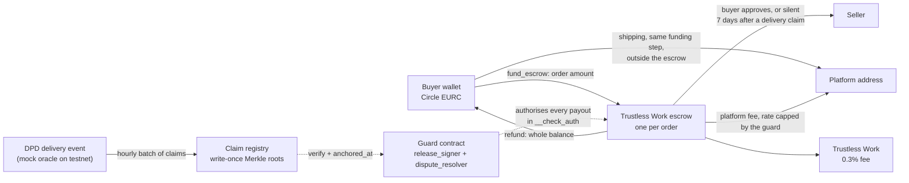
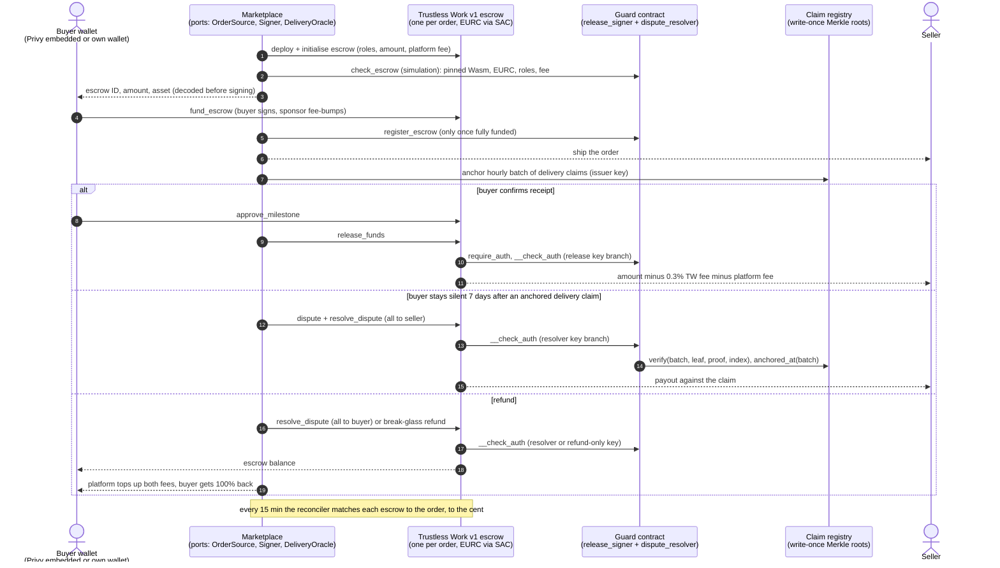

# motored-stellar

[](https://github.com/zbagdzevicius/motored-stellar/actions/workflows/ci.yml)
[](LICENSE)

**Escrow for used car part orders paid in Circle EURC on Stellar: the buyer's money waits in a
Trustless Work escrow, and our guard contract decides who it may be paid to.**

Built by UAB Motored, which runs a live used car parts marketplace ([motored.lt](https://motored.lt)).
This is the open-source, chain-side part of the EURC integration proposed for a Stellar Community
Fund (SCF #46) Integration Track award.

> **Status: testnet only, unaudited.** Do not hold real value with this code before an external
> review. See [SECURITY.md](SECURITY.md).

**The ask:** USD 50,400 from the SCF #46 Integration Track, for the billed deliverables listed in
[SCF #46 deliverables](#scf-46-deliverables-and-where-they-live) (budget in
[docs/scf-46-architecture.md, section 10](docs/scf-46-architecture.md#10-build-plan-and-effort-matches-the-submission-budget)).
Everything in this repository at the time of that proposal is pre-award work and is not billed.
Reconciliation, the event indexer and the alert policies are funded by Motored, not billed: Motored
still runs them and publishes the daily reconciliation report and the weekly signed snapshots that
[docs/metric.md](docs/metric.md) recomputes the metric from.

## Why Stellar

- **Circle issues EURC on Stellar.** Runs 8 and 9 below settled in Circle's own testnet EURC, not
  a stand-in, through its Stellar Asset Contract.
- **Buyers need no XLM.** Sponsored accounts, sponsored EURC trustlines (CAP-33) and fee-bumps let
  the platform pay network costs while the buyer signs only their own payment
  ([wallet lab proofs](docs/testnet-proofs.md#sponsored-accounts-and-fee-bumps-wallet-lab-24-oct-2026)).
- **A contract can hold the escrow's keys.** A Soroban custom account lets our guard hold the
  `release_signer` and `dispute_resolver` roles on Trustless Work's deployed escrow and check every
  payout inside `__check_auth`, without forking Trustless Work.

## Proof in 60 seconds

Latest run: **run 9, 29 Oct 2026, guard v0.10 on Circle testnet EURC** (issuer `GB3Q6QDZ...3NM2ZTVO`,
Circle's published testnet address), from this repository's own scripts. 2 EURC orders; platform fee
470 bps plus Trustless Work's 0.3%, so the seller receives 1.9 EURC.

| What | Evidence |
|---|---|
| Buyer-approved release through the guard; seller received 1.9 EURC | [`f2cdbd2c87eb...`](https://stellar.expert/explorer/testnet/tx/f2cdbd2c87eb0d525efce66bd73d8e179afbfb50e5ac735a9c33b88a9e355618) |
| Seller paid 1.9 EURC alone past a buyer with no EURC trustline (`withdraw_remaining_funds`); dust left for the buyer ([run 9 row](#testnet-runs)) | [`2d696d8b8ba7...`](https://stellar.expert/explorer/testnet/tx/2d696d8b8ba704ed3338c1cb061db6ea9519e2829ce2036abd06e3069a3ae972) |
| Over-cap refusal: `register_escrow` of an escrow at 501 bps (cap 500) **failed on the ledger** with `PlatformFeeOverCap` = 29 | [`54a5c520f859...`](https://stellar.expert/explorer/testnet/tx/54a5c520f8597780074919bbe09a4d8349ebafc8988f5bca733bd29c8dd65e4c) |
| ...and the escrow at exactly 500 bps registered | [`1bd128eb6dea...`](https://stellar.expert/explorer/testnet/tx/1bd128eb6dea7367d386c31c4bbbddc7a029b2a3b77d8438af0538d853175579) |
| Guard v0.10 contract (platform fee cap 500 bps) | [`CCRZHNU2...J2KVUZ`](https://stellar.expert/explorer/testnet/contract/CCRZHNU2CHN62BXALEFHAJEX57AURBB7OWYM37I7JSO7HLALHVJ2KVUZ) |
| Claim registry v0.10 contract | [`CC6K26NQ...Q5FBDX`](https://stellar.expert/explorer/testnet/contract/CC6K26NQGSD3UAIUS463ZJCEC7SGEF6V5R34OYZX3WHY6URFTKQ5FBDX) |
| Circle testnet EURC (Stellar Asset Contract) | [`CCUUDM43...R4MCGZ`](https://stellar.expert/explorer/testnet/contract/CCUUDM434BMZMYWYDITHFXHDMIVTGGD6T2I5UKNX5BSLXLW7HVR4MCGZ) |
| Escrow code | Trustless Work's own deployed testnet Wasm `7c3f7b2a`, unmodified |
| Earlier runs | Runs 4 to 8: release, dispute refund, break-glass refund, silent-buyer payout against a depth-32 delivery claim, buyer contest, four refusals landed as failed transactions ([table below](#testnet-runs)) |
| CI (last logged green run) | All four jobs green on the v0.9 commits ([run 40855043032](https://github.com/zbagdzevicius/motored-stellar/actions/runs/40855043032), logged in [docs/verification.md](docs/verification.md)); the badge above shows the latest push |
| Tests | 99 Rust contract tests (guard 88, claim registry 11) and 462 TypeScript tests, counted locally on 29 Oct 2026 |

Every transaction of run 9 is in
[docs/testnet-proofs.md, Run 9](docs/testnet-proofs.md#run-9-guard-v010-on-circle-testnet-eurc-29-oct-2026-1903-to-1910-utc).

## How the money moves

One Trustless Work escrow per order. The guard holds both payout roles, so no payout happens
without passing its rules.



On testnet the delivered event comes from a mock oracle, not a carrier; claims from live DPD
tracking are part of deliverable D6. On a refund the platform tops up both fees, so the buyer gets
100% back. The step-by-step sequence is in [The order flow](#the-order-flow).

## Where to look

| If you want | Read |
|---|---|
| The SCF #46 architecture: components, contract interfaces, keys, failure modes, budget and tranche mapping, open partner questions (testnet only, unaudited) | [docs/scf-46-architecture.md](docs/scf-46-architecture.md) |
| The design in full | [docs/architecture.md](docs/architecture.md) |
| What can go wrong and how it is contained | [docs/threat-model.md](docs/threat-model.md), [docs/trust-model.md](docs/trust-model.md) (who can do what with which key) |
| The on-chain release metric | [docs/metric.md](docs/metric.md) |
| Every testnet contract ID and transaction hash, dated, with stellar.expert links | [docs/testnet-proofs.md](docs/testnet-proofs.md) |
| Unit-test results, fees and instruction counts per run, and the protocol facts checked against Trustless Work's source and Horizon | [docs/verification.md](docs/verification.md) |
| The contracts | [contracts/guard](contracts/guard), [contracts/claim-registry](contracts/claim-registry), [contracts/README.md](contracts/README.md) |
| How a marketplace plugs in | [docs/integration-guide.md](docs/integration-guide.md) |

## Contents

- [What is proven today](#for-reviewers-what-is-proven-today)
  - [Testnet runs](#testnet-runs)
  - [What guard v0.10 adds](#what-guard-v010-adds)
  - [Provenance](#provenance)
  - [Tests and CI](#tests-and-ci)
  - [Not yet done](#not-yet-done)
- [Design decisions we made](#design-decisions-we-made)
- [The order flow](#the-order-flow)
- [Components](#components)
- [Quickstart](#quickstart)
- [SCF #46 deliverables and where they live](#scf-46-deliverables-and-where-they-live)
  - [Status of each part](#status-of-each-part)
- [Contributing, security, license](#contributing-security-license)

## For reviewers: what is proven today

Everything here is standalone: nothing imports the marketplace's private order system. Where a
marketplace plugs in, there is a small typed port (`OrderSource`, `DeliveryOracle`, `Signer`,
`LedgerSource`, ...) with an in-memory implementation used by the tests and the example.

This repository holds the guard and registry contracts, the TypeScript adapters (escrow, claims,
EURC, wallets, ramps, reconciler), the testnet scripts and their unit tests, and a CI workflow. The
guard tests run every rule against both deployed Trustless Work Wasm files.

### Testnet runs

Every escrow ran Trustless Work's own testnet Wasm (`7c3f7b2a`). In all runs the seller-payout
delay and the contest window were shortened from 7 days to 120 s so a run fits in minutes.

| Run | Date | Guard | Asset | What landed on the ledger | Links |
|---|---|---|---|---|---|
| 1 to 3 (lab) | 24 Oct 2026 | v0.6 to v0.8 | lab-issued stand-in | A guard-authorised release after buyer approval, a seller payout against a depth-32 delivery claim verified inside `__check_auth`, a break-glass refund, the buyer's contest, overfunding and dust cases | [Provenance](#provenance) |
| 4 | 28 Oct 2026 | v0.8 + claim registry | `XEUR` lab asset | A release after buyer approval (its delivery claim re-checked afterwards, off-chain, with `npm run claims:recheck`), a dispute refund with the fee top-up, a partial-funding break-glass refund; refused paths were simulations | [Run 4](docs/testnet-proofs.md#run-4-guard-v08-from-this-repositorys-scripts-28-oct-2026-0937-to-0939-utc) |
| 5 | 28 Oct 2026 | v0.8 (same deployment) | `XEUR` lab asset | `npm run testnet:e2e-claims`. Silent-buyer payout: escrow funded, buyer silent, platform dispute, a delivery claim anchored with a 32-level Merkle proof that the guard checked inside `__check_auth`, the seller paid through dispute resolution after the 120 s delay, then a public re-check of the claim. Buyer contest: buyer approval, seller dispute, the buyer's `contest` on the guard inside the window, the seller payout refused with `Contested` = 25 in simulation, the whole balance refunded to the buyer and the fees topped up | [Run 5](docs/testnet-proofs.md#run-5-silent-buyer-and-buyer-contest-from-this-repositorys-scripts-28-oct-2026-2208-to-2211-utc) |
| 6 | 29 Oct 2026 | v0.8 (same deployment) | `XEUR` lab asset | `npm run testnet:refusals`. Four refused payouts landed as **failed transactions** carrying the guard's own error code, each followed by the legitimate settlement of the same escrow: wrong fee address (`BadFeeAddr` = 15), seller payout with no delivery claim (`NoClaim` = 8), break-glass payout to the seller (`NotWholeToBuyer` = 13), seller payout while the buyer's contest stands (`Contested` = 25) | [Run 6](docs/testnet-proofs.md#run-6-refusals-landed-as-failed-transactions-29-oct-2026-0702-to-0705-utc) |
| 7 | 29 Oct 2026 | v0.9 (fresh deployment) | lab asset | The run 4 and run 5 scenarios again (release, dispute refund, break-glass refund, silent-buyer payout against a depth-32 claim, buyer contest), then the extended TTLs read back from the ledger | [Run 7](docs/testnet-proofs.md#run-7-guard-v09-with-ttl-upkeep-29-oct-2026-0927-to-0935-utc) |
| 8 | 29 Oct 2026 | v0.9 + registry (fresh deployment) | **Circle testnet EURC** | Every scenario above with 2 EURC orders (release, dispute refund, break-glass refund, silent-buyer payout against a depth-32 claim, buyer contest and refund) and the four refusals of run 6 landed again as failed transactions in EURC. Both anchored claims re-check `ok` with `npm run claims:recheck -- --from-state` | [Run 8](docs/testnet-proofs.md#run-8-real-circle-testnet-eurc-guard-v09-29-oct-2026-1156-to-1205-utc) |
| 9 | 29 Oct 2026 | **v0.10** + fresh registry | **Circle testnet EURC** | Buyer-approved release (2 EURC order, seller paid 1.9 EURC); the seller-only `withdraw_remaining_funds` payout past a buyer who removed their EURC trustline after 1 unit of dust was sent to the escrow (seller paid 1.9 EURC alone, the dust left for the buyer, the registration closed); an escrow 1 bp over the fee cap whose `register_escrow` failed with `PlatformFeeOverCap` = 29, next to one at the cap that registered | [Run 9](docs/testnet-proofs.md#run-9-guard-v010-on-circle-testnet-eurc-29-oct-2026-1903-to-1910-utc) |

Notes on the runs:

- **Run 4 deployment path.** Every escrow was created by an escrow-factory instance the run
  deployed from Trustless Work's testnet Wasm, calling its built-in deployer function. Release and
  resolve go straight to the escrow contract, because the guard authorises through a Soroban auth
  entry checked in its `__check_auth`, which the API's unsigned-XDR flow for G-account signers does
  not build, so we build and simulate those calls ourselves.
- **Guard v0.9** is the v0.8 rules plus in-contract TTL upkeep: the guard extends its instance and
  every registration it touches to 60 days once 30 or fewer remain.
- **Delivery events** on testnet came from the scripts' mock oracle, not a carrier; claims from
  live DPD tracking are part of D6.
- **Metric.** The on-chain metric script was run against the real escrows of runs 4 to 7; it prints
  FAIL, as expected for a few test escrows
  ([docs/metric.md](docs/metric.md#real-output-on-testnet-runs-4-to-7-29-oct-2026)).
- **Testnet resets** erase these entries. The runs are reproducible with `npm run testnet:keys`,
  `testnet:deploy`, `testnet:e2e`, `testnet:e2e-claims`, `testnet:refusals` and `testnet:v010`, and
  are re-run and re-logged after any reset.

### What guard v0.10 adds

Guard v0.10 (29 Oct 2026) adds three things to v0.9:

- **A seller dispute payout that no buyer leg can block.** `withdraw_remaining_funds` may pay the
  seller under the same rules as a resolution, capped and once, so a buyer who removes their
  trustline and dusts the escrow cannot hold the seller's share.
- **A cap on the escrow's platform fee rate** (`max_platform_fee_bps`, error `PlatformFeeOverCap` =
  29). See [the order flow](#the-order-flow) for how the cap is set and how shipping is paid.
- **TTL values of 120 / 150 days** for the guard and the registry, at or above mainnet's minimum
  persistent TTL ([contracts/README.md](contracts/README.md)).

### Provenance

The guard and registry were developed in a private lab workspace and moved here with the same logic
for run 4 on 28 Oct 2026. Lab runs, all 24 Oct 2026, built from the lab crate `lab-guard` (so their
Wasm hashes differ from this repository's build):

- run 1, guard v0.6 ([guard-authorised release](https://stellar.expert/explorer/testnet/tx/1db534873a2782f8e73eed638a73c816cbeaaea69a64279047ef4591f12e96e1));
- run 2, guard v0.7 ([buyer `contest`](https://stellar.expert/explorer/testnet/tx/82c18aa74596f17ea520ece62c7169f2f760287216b57c5005c26da53ec1c9a5));
- run 3, guard v0.8 ([guard deployed](https://stellar.expert/explorer/testnet/tx/1ac5c84bab7cc90f06a5ab4305938d7a01e60bf84e35327343f01ce11fd5cb47)).

In the lab runs a lab-issued asset stood in for EURC; every tx is linked in
[docs/testnet-proofs.md](docs/testnet-proofs.md).

The initial published history (pushed 29 Oct 2026) ends at the tag `pre-award-baseline`; diff any
billed deliverable against that tag. The tag `pre-award-filing` marks the state of this repository
on the SCF #46 filing day.

### Tests and CI

- **Now:** 99 Rust contract tests (guard 88, claim registry 11) and 462 TypeScript tests, counted
  locally on 29 Oct 2026 with guard v0.10, its platform fee cap and shipping paid outside the escrow
  (`cargo test` and vitest across the eight workspaces).
- **CI:** the workflow runs on every push; CI on the v0.9 commits is green
  ([run 40855043032](https://github.com/zbagdzevicius/motored-stellar/actions/runs/40855043032),
  logged in [docs/verification.md](docs/verification.md)).

<details>
<summary>Earlier test counts</summary>

Before shipping moved out of the escrow the TypeScript count was 453; before the fee cap they were
95 and 448; the v0.9 counts were 83 and 413. Earlier counts (382 and 388 locally, 76 and 393 in the
[CI run before v0.9](https://github.com/zbagdzevicius/motored-stellar/actions/runs/40839759344))
are logged in [docs/verification.md](docs/verification.md).

</details>

### Not yet done

Planned, see the [status table](#status-of-each-part):

- live Privy, Stellar Wallets Kit and Bridge sandbox runs;
- the remaining refused paths as landed failed transactions (four are landed in runs 6 and 8, and
  the fee-cap refusal in run 9; the others are unit tests plus enforce-mode simulations);
- guard and registry Wasm verified on stellar.expert from a tagged commit;
- a fired test alert;
- the first tagged release.

## Design decisions we made

- **A guard contract, not a fork of Trustless Work.** We do not modify Trustless Work's contract:
  every escrow runs its deployed code, and the guard pins that Wasm hash per network and holds
  the `release_signer` and `dispute_resolver` roles, so every payout passes our rules. The guard
  tests run against both deployed Wasm files.
- **A claim registry.** A silent buyer's seller payout is bound to a public, write-once record of
  the carrier's delivery event, anchored after full funding and at least 7 days old by the
  registry's own timestamp, which the platform cannot backdate; an offline revoker key stops a
  bad batch from paying. It does not prove delivery on its own; it makes every such payout
  auditable ([trust model](docs/trust-model.md)).
- **Break-glass is refund-only.** If a guard defect blocks release or refund, an offline key can
  still return a disputed escrow's whole balance to its buyer, but it cannot pay the seller or
  anyone else, so the emergency path cannot move money away from the buyer
  ([threat model](docs/threat-model.md)).

## The order flow

One Trustless Work v1 single-release escrow per order, paid in Circle EURC. The guard contract
holds both the `release_signer` and `dispute_resolver` roles, so every payout passes its rules.



What the guard enforces:

- It pays only that escrow's buyer or its seller, plus the two fee recipients it pins: Trustless
  Work's fee account and the platform address.
- The platform fee rate is set when the escrow is created and checked against the order by
  Motored's backend. Since v0.10 the guard refuses to register an escrow whose rate is above its
  cap, set per deploy (500 bps in run 9; 1,000 bps planned for mainnet). Shipping is paid to the
  platform address in the funding step, outside the escrow. An order whose quote is above the cap
  stays on the card rail.
- It never pays the seller more than the escrow amount.
- It pays the seller without the buyer's approval only against a delivery claim anchored after the
  escrow was fully funded and at least 7 days old; a buyer-signed `contest` switches off the one
  claimless seller path.
- The break-glass key can only refund.

Full design: [docs/architecture.md](docs/architecture.md). Who can do what with which key:
[docs/trust-model.md](docs/trust-model.md).

## Components

| Path | What it is | Language |
|---|---|---|
| [`contracts/guard`](contracts/guard) | `motored-escrow-guard`: Soroban custom account. `__check_auth` with release, resolver and refund-only break-glass branches; `check_escrow`, `register_escrow`, `contest`, timelocked key rotation | Rust, soroban-sdk 26 |
| [`contracts/claim-registry`](contracts/claim-registry) | Write-once Merkle roots of delivery claims, `verify`, `anchored_at`, `revoke` | Rust |
| [`contracts/test-fixtures/fake-escrow`](contracts/test-fixtures/fake-escrow) | Look-alike escrow for negative tests (never deployed) | Rust |
| [`packages/escrow`](packages/escrow) | Trustless Work client (REST + on-chain deployer path), guard-authorised release service, precheck, event reader, fee, cap, rounding and refund rules, all shared ports | TypeScript |
| [`packages/claims`](packages/claims) | Claim leaf, hourly Merkle batches, anchoring job, public re-check, TTL upkeep | TypeScript |
| [`packages/eurc`](packages/eurc) | EURC constants and SAC id, trustline checks, CAP-33 sponsored accounts and trustlines, allowlisted fee-bump service | TypeScript |
| [`packages/wallets`](packages/wallets) | `WalletProvider` port: Privy embedded wallets (raw-hash signing), Stellar Wallets Kit, local keypair wallet, transaction review | TypeScript |
| [`packages/ramps`](packages/ramps) | `RampProvider` port: Bridge EUR virtual accounts and EURC liquidation addresses, Travel Rule data, receiver guards, fee gross-up quotes | TypeScript |
| [`packages/reconciler`](packages/reconciler) | 15-minute reconciliation, daily pass/fail report, the on-chain release metric | TypeScript |
| [`scripts`](scripts) | Testnet keys (runtime only), deploy, end-to-end run, metric CLI, public claim re-check, `check-secrets.sh`, docs lint | TypeScript, bash |
| [`examples/order-flow`](examples/order-flow) | One order through every port, in memory; `--testnet` hands off to the testnet run | TypeScript |
| [`docs`](docs) | Architecture (incl. the [SCF #46 architecture](docs/scf-46-architecture.md)), trust and threat models, leaf format, metric, integration guide, verification log, testnet proofs | Markdown |

## Quickstart

Requirements: Node >= 22.12, Rust 1.93.0 with the `wasm32v1-none` target (pinned by
`contracts/rust-toolchain.toml`) and the [Stellar CLI](https://developers.stellar.org/docs/tools/cli)
(the lab used 23.4.0).

```bash
# 1. TypeScript packages and the example (in memory, no network)
npm install
npm run typecheck
npm test                         # docs lint + vitest in every workspace
npm run example                  # one order: fund, anchor claim, release, refund, reconcile

# 2. Contracts
cd contracts
./third_party/tw-wasm/fetch.sh   # fetch Trustless Work's deployed Wasm by hash, verify sha256
                                 # (mainnet file needs TW_MAINNET_RPC_URL, read-only)
stellar contract build            # guard, claim-registry, fake-escrow -> contracts/target/wasm32v1-none/release
cargo test                       # guard tests run against both Trustless Work Wasm lineages
cd ..

# 3. Testnet (manual; keys are generated at runtime into .keys/, which is git-ignored)
npm run testnet:keys             # Keypair.random() + friendbot, prints public keys only
npm run testnet:deploy           # XEUR stand-in for EURC + its SAC, registry, guard
                                 # (or --asset EURC:<Circle testnet issuer> for real testnet EURC, see scripts/README.md)
npm run testnet:e2e              # release with a claim, refund + top-up, partial-funding refund
npm run testnet:e2e-claims       # silent buyer paid against a depth-32 claim; buyer contest + refund (waits ~2 min)
npm run claims:recheck -- --from-state   # anyone can re-check a released order's claim
npm run metric -- --footprint <footprint.json>   # recompute the release metric from chain data

./scripts/check-secrets.sh       # run before every commit
```

CI ([`.github/workflows/ci.yml`](.github/workflows/ci.yml)) uses no secrets. The contracts job
reads Trustless Work's mainnet Wasm by hash, so it needs a repository **variable** (not a secret)
`TW_MAINNET_RPC_URL` set to any public Stellar mainnet RPC endpoint. The testnet run is manual.

## SCF #46 deliverables and where they live

The deliverable IDs match the SCF #46 proposal. "Pre-award" is what this repository already holds
and is not billed; "billed" is the remaining work the award would pay for. Motored's own checkout UI,
admin screens and marketplace code stay private and plug into the ports here; the Stellar-facing
wiring of each billed deliverable ships here under Apache-2.0. Each is checked through a public
artefact (CI tests of the rules it imports, or testnet tx hashes mapped to order references in
[docs/testnet-proofs.md](docs/testnet-proofs.md)).

| ID | Scope | In this repository | Pre-award (not billed) | Billed remaining work |
|---|---|---|---|---|
| D1 | Trustless Work escrow in EURC on testnet, guard in both roles | [`packages/escrow`](packages/escrow), [`scripts/testnet`](scripts/testnet) | REST client in [`packages/escrow/src/tw-rest.ts`](packages/escrow/src/tw-rest.ts), drafted against Trustless Work's OpenAPI schema; request and response shapes are verified against the live v1 API in D1 (each open shape is marked `TODO(verify, D1 live API run)`); deployer path, lifecycle, precheck, event reader, release service; deployer path ran on testnet (run 4), and with Circle's testnet EURC (run 8) | Live v1 REST API runs (or the on-chain deployer, if Trustless Work confirms the API does not take a contract address in both roles, or has not answered within 10 working days of our dated written request, linked in the run log); Circle testnet EURC |
| D2 | Wallets, sponsored accounts, EURC trustlines, fee-bumps | [`packages/wallets`](packages/wallets), [`packages/eurc`](packages/eurc) | Privy and Wallets Kit adapters, CAP-33 sponsorship, fee-bump policy; tx shapes lab-proven ([proofs](docs/testnet-proofs.md#sponsored-accounts-and-fee-bumps-wallet-lab-24-oct-2026)) | Browser runs with real wallets; Circle testnet EURC; measured fee caps; key custody |
| D3 | Order system on the escrow (escrow order states, payouts settled by the release, disputes and refunds; eligibility rules, the escrow ledger, seller checks and escrow emails are funded by Motored, not billed) | Rules only: [`packages/escrow/src/fees.ts`](packages/escrow/src/fees.ts); `OrderSource`, `DeliveryOracle`, `LedgerSource` ports | Fee, cap, rounding and refund rules with tests | A new `packages/escrow-orders` (escrow order-state machine), with public CI tests; marketplace screens stay private |
| D4 | Checkout on the EURC rail, end-to-end test | [`examples/order-flow`](examples/order-flow), [`scripts/testnet/e2e.ts`](scripts/testnet/e2e.ts), [`scripts/testnet/e2e-claims.ts`](scripts/testnet/e2e-claims.ts) | In-memory flow and the scripted testnet run | Private checkout UI; end-to-end run log appended to testnet-proofs.md |
| D5 | Bridge on-ramp and off-ramp in sandbox | [`packages/ramps`](packages/ramps) | Offline unit tests | Sandbox runs |
| D6 | Guard and claim registry: production hardening, claims from live DPD tracking | [`contracts/guard`](contracts/guard), [`contracts/claim-registry`](contracts/claim-registry), [`packages/claims`](packages/claims), [`packages/escrow/src/release-service.ts`](packages/escrow/src/release-service.ts) | Guard v0.10 (v0.9 rules plus an unblockable seller payout, a platform fee cap and mainnet-sized TTL) and registry; lab runs 1-3, runs 4-6 (v0.8), run 7 (v0.9), run 8 (v0.9 on Circle testnet EURC), run 9 (v0.10 on Circle testnet EURC) | The remaining refused paths as landed failed txs (four landed in run 6, the fee-cap refusal in run 9); key-rotation and migration drill; `Anchored` event; registry-root TTL top-up by the anchoring job; Wasm verified on stellar.expert |
| D7 | Threat model and monitoring plan (reconciliation and alert policies funded by Motored, not billed) | [`docs/threat-model.md`](docs/threat-model.md), [`docs/trust-model.md`](docs/trust-model.md), [`packages/reconciler`](packages/reconciler) | Written; reconciler with unit tests | Sections for Bridge, sanctions, the wallet and checkout integration and order-system races, with the 14-alert monitoring plan. Not billed, run by Motored: the 15-minute escrow-to-order reconciliation as a `packages/reconciler` extension with a one-cent-gap CI test, and the alert policies |
| D8 | Testnet hardening from pilot sessions, testnet regression suite | Failure-state tests and the CI regression suite land here | None | Billed |
| D9 | Escrow operations console | Private (Motored's admin) | None | Not billed: funded by Motored |
| D10 | Mainnet cutover | Mainnet deployment record lands in testnet-proofs.md's mainnet section | None | Billed; after the legal opinion, with per-order and open-value caps until an external review |
| D11 | Seller EURC payouts, refunds after release | Off-ramp in [`packages/ramps`](packages/ramps); records are private | None | Billed (invoices and DAC7 records are funded by Motored, not billed) |
| D12 | Live rollout and mainnet failure states (indexer, reconciler and metric in production funded by Motored, not billed) | [`packages/reconciler`](packages/reconciler), [`scripts/metric`](scripts/metric), [`docs/metric.md`](docs/metric.md) | Reconciler, daily report and metric with unit tests | Billed: mainnet rollout, a test per failure state, error mapping from U5. Not billed, run and published by Motored: indexer beyond RPC retention, daily report, weekly signed snapshots |
| D13 | Open-source release, mainnet canary | This repository, [`docs/integration-guide.md`](docs/integration-guide.md) | Draft integration guide | First tagged release; read-only mainnet canary |
| U1-U5 | User testing (pilots, LT and EN copy, video, help pages, interviews) | Not code | None | Billed in Tranches 2-3 |

### Status of each part

"Lab-proven" means the code ran in the SCF architecture lab, against Trustless Work's deployed
Wasm and on testnet, before it was ported here. "Unit tests written" means the tests are in this
repository and run in CI (run links in [docs/verification.md](docs/verification.md)).

| Part | Implemented | Tested | Not yet |
|---|---|---|---|
| Guard contract v0.10 (v0.9 rules plus an unblockable seller payout, a platform fee cap and mainnet-sized TTL; v0.9 = v0.8 plus TTL upkeep) | yes | lab-proven (v0.8: 66/66 in the lab, 3 testnet runs); 88 tests here; runs 4 to 6 (v0.8), run 7 (v0.9), run 8 (v0.9 on Circle testnet EURC), run 9 (v0.10 on Circle testnet EURC: release, seller-only withdrawal, fee-cap refusal) | external audit |
| Claim registry | yes | lab-proven on testnet; 11 unit tests (v0.10 adds in-contract TTL upkeep) | `Anchored` event for indexers |
| Escrow adapter and release service | yes | unit tests written | live run against the TW v1 REST API |
| Claims batching, re-check, TTL upkeep | yes | unit tests + golden vectors shared with Rust; the guard's own TTL upkeep ran in run 7 | registry-root TTL top-up by the anchoring job, run live |
| EURC sponsorship and fee-bump policy | yes | unit tests; tx shapes lab-proven on testnet | fee caps measured against real `fund_escrow` |
| Wallets (Privy, Wallets Kit) | yes | offline unit tests | browser run with real wallets |
| Ramps (Bridge) | yes | offline unit tests | Bridge sandbox run |
| Reconciler and metric | yes | unit tests on fixtures | indexer beyond RPC event retention |
| Testnet scripts | yes | unit tests for pure parts; run on testnet 28 Oct 2026 ([run 4](docs/testnet-proofs.md#run-4-guard-v08-from-this-repositorys-scripts-28-oct-2026-0937-to-0939-utc)) | runs with Circle testnet EURC |
| Mainnet | no | | planned after the legal opinion, capped until an external review |

Every unconfirmed external fact is marked `TODO(verify, Dn)` in the code, naming the deliverable
whose run closes it, and listed in each package README. Markers answered by a testnet run carry a
one-line note of the run instead.

## Contributing, security, license

- [CONTRIBUTING.md](CONTRIBUTING.md): ground rules (standalone, testnet only, no secrets).
- [SECURITY.md](SECURITY.md): report to security@motored.lt. No bug bounty.
- Apache-2.0, copyright 2026 UAB Motored. See [LICENSE](LICENSE) and [NOTICE](NOTICE). Trustless
  Work's contracts are not vendored; their deployed Wasm is fetched by hash for tests only.

Code and docs are AI-assisted and reviewed by a human before merge.
